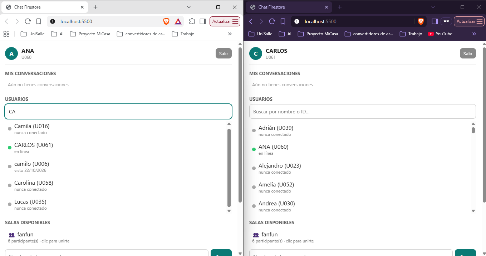
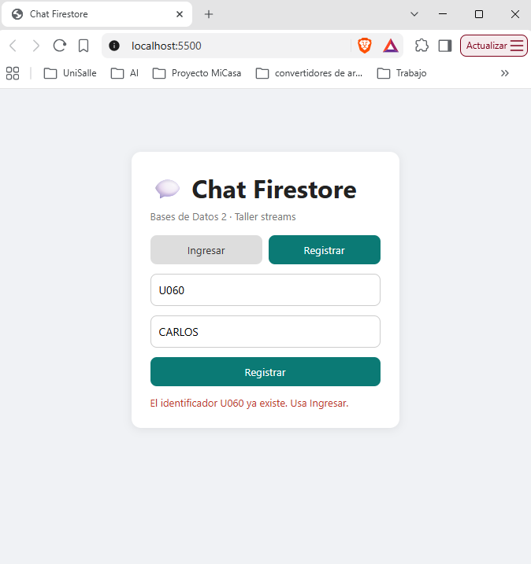
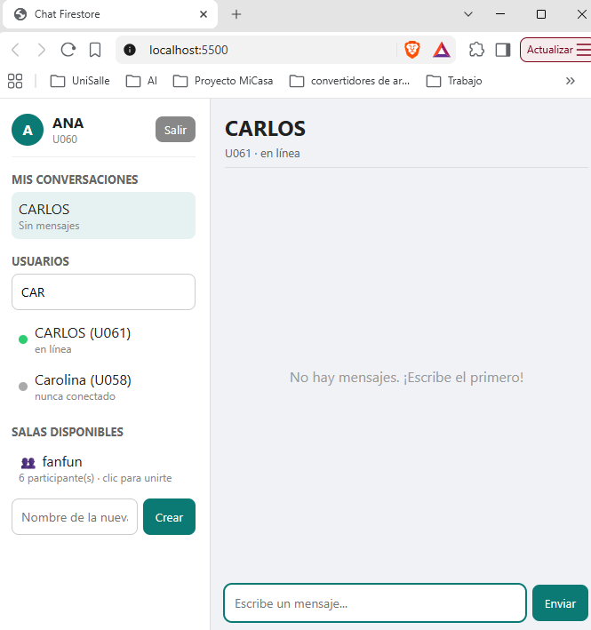
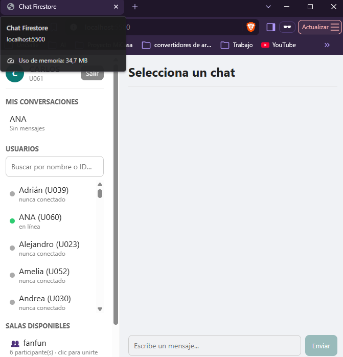
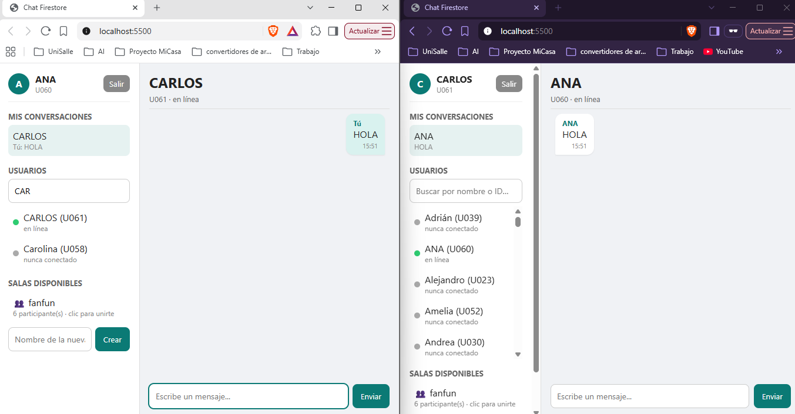
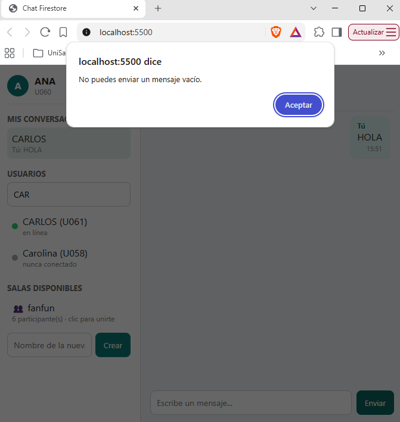
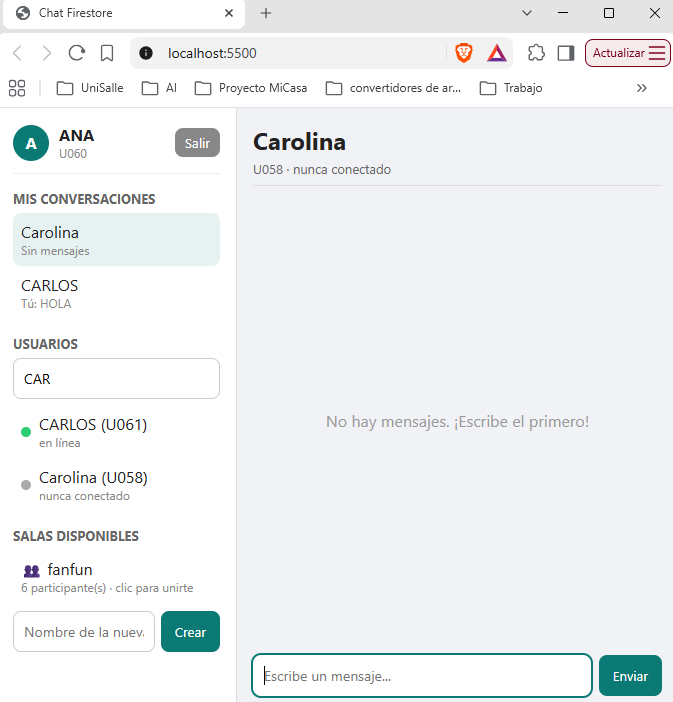
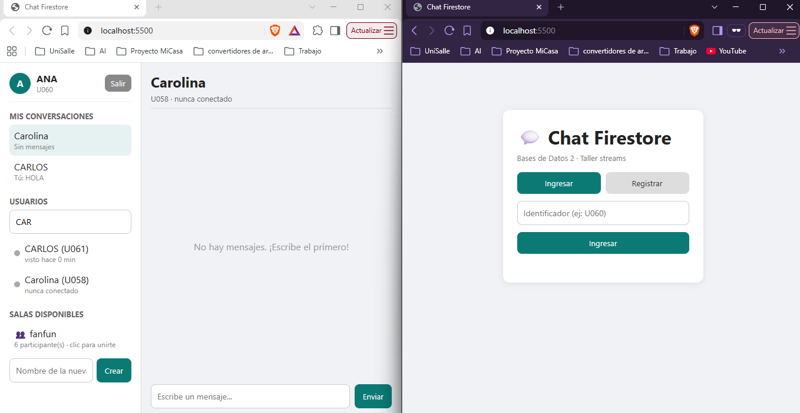

# Chat en tiempo real con Cloud Firestore

Taller Streams · Bases de Datos 2 · Universidad de La Salle
Alternativa elegida: **B. Chat web con HTML, CSS y JavaScript** (SDK modular de Firebase 12).

**Integrantes**
- Santiago Fonseca
- Leonardo López
- Jacobo Caballero
- Camilo López

## Cómo ejecutarlo

La página usa módulos ES, así que necesita un servidor local (no basta con abrir el archivo).
Desde la carpeta del proyecto:

```bash
python -m http.server 5500
```

o la extensión **Live Server** de VS Code. Luego abrir `http://localhost:5500`.

| Archivo | Contenido |
|---|---|
| `index.html` | Interfaz: ingreso/registro, listas laterales y área del chat |
| `styles.css` | Estilos |
| `logica.js` | Lógica de la aplicación (equivale al `app.js` del enunciado) |
| `firebase.js` | Inicialización de Firebase y exportación de `db` |
| `firestore.rules` | Reglas de seguridad propuestas |
| `evidencias/` | Capturas de las pruebas funcionales |

---

## 1. Arquitectura de datos

```
usuarios/{usuarioId}
    nombre        string     nombre visible (puede repetirse)
    estado        string     "online" | "offline" (lo que reporta el cliente)
    lastSeen      timestamp  último latido, hora del servidor
    creadoEn      timestamp  fecha de registro

conversaciones/{conversacionId}
    tipo          string     "privada" | "grupo"
    participantes array      IDs de usuario
    nombre        string     solo en grupos
    creadaPor     string     solo en grupos
    creadaEn      timestamp
    actualizadaEn timestamp  hora del último mensaje
    ultimoMensaje string     vista previa (máx. 80 caracteres)
    ultimoEmisorId string    quién envió el último mensaje

    mensajes/{mensajeId}            (subcolección)
        emisorId     string     ID de quien envía
        emisorNombre string     nombre visible al momento de enviar
        texto        string     1 a 1000 caracteres
        creadoEn     timestamp  hora del servidor (serverTimestamp)
```

### Justificación: qué consulta u operación permite cada parte

| Elemento | Para qué se usa |
|---|---|
| `usuarios/{usuarioId}` con el ID como clave del documento | Leer o crear un usuario con `getDoc`/`setDoc` sin consultas. El ID es la identidad y es **distinto del nombre visible**: dos personas pueden llamarse "Santiago" sin confundirse. |
| `estado` + `lastSeen` | Mostrar la lista de usuarios con su disponibilidad (`onSnapshot(collection("usuarios"))`). |
| `conversaciones` como colección raíz (no dentro de cada usuario) | Una conversación pertenece a todos sus participantes. Si estuviera dentro de `usuarios/u001` habría que duplicarla en `usuarios/u002`. |
| `participantes` (array) | Consulta "mis conversaciones": `where("participantes", "array-contains", miId)`. Sirve igual para chats privados y grupos. |
| `tipo` | Consulta "salas disponibles": `where("tipo", "==", "grupo")`, y distinguir cómo se titula cada chat. |
| `ultimoMensaje`, `ultimoEmisorId`, `actualizadaEn` | Pintar la lista de conversaciones ordenada y con vista previa **sin leer la subcolección de mensajes** de cada una. Es una desnormalización: se actualiza en el mismo *batch* que guarda el mensaje. |
| `mensajes` como **subcolección** | Los mensajes pueden ser miles; en un array dentro del documento se superaría el límite de 1 MiB por documento y cada mensaje reescribiría todo el chat. En subcolección se consultan con `orderBy("creadoEn")` y se escuchan por separado. |
| `emisorNombre` en el mensaje | Mostrar el nombre sin buscar al usuario. Es una copia: si el usuario cambia su nombre, los mensajes viejos conservan el anterior (limitación aceptada). |
| `creadoEn = serverTimestamp()` | El orden lo decide el reloj del servidor, no el de cada computador (que puede estar adelantado o atrasado). |

### Consultas que usa la aplicación

| Consulta | Código | Tipo |
|---|---|---|
| Todos los usuarios | `collection(db, "usuarios")` | `onSnapshot` |
| Mis conversaciones | `query(conversaciones, where("participantes", "array-contains", yo.id))` | `onSnapshot` |
| Salas | `query(conversaciones, where("tipo", "==", "grupo"))` | `onSnapshot` |
| Mensajes de un chat | `query(conversaciones/{id}/mensajes, orderBy("creadoEn", "asc"))` | `onSnapshot` |
| Un usuario / una conversación | `doc(db, "usuarios", id)` / `doc(db, "conversaciones", id)` | `getDoc` / transacción |

Ninguna necesita índice compuesto (cada una filtra u ordena por un solo campo).
La lista de conversaciones se ordena por `actualizadaEn` en el cliente para no requerir un índice `participantes + actualizadaEn`.

---

## 2. Consistencia

### Identificador de usuario único
- Los IDs de documento en Firestore **distinguen mayúsculas y minúsculas**: `u023` y `U023` son documentos diferentes. Esto ocurrió en la base (existen `U001` y `u001`, ambos "santiago").
- Solución: los IDs nuevos se guardan **en mayúsculas**. Al registrar se busca el ID tal como se escribió y también en mayúsculas; si cualquiera existe, se rechaza. Los IDs antiguos en minúscula siguen pudiendo ingresar.
- Solo se permiten letras, números y guiones (2 a 20). El guion bajo `_` no se permite porque se usa para formar los IDs de chats privados.
- El registro se hace en una **transacción** (`runTransaction`): si dos personas registran el mismo ID al mismo tiempo, solo una lo logra.

### Conversaciones privadas sin duplicados
El ID de la conversación es **determinista**: los dos IDs ordenados y unidos con `_`.

```
U002 abre chat con U001  ->  ["U001","U002"].sort().join("_")  ->  "U001_U002"
U001 abre chat con U002  ->  mismo ID                          ->  "U001_U002"
```

Como la clave del documento es única en la colección, **no pueden existir dos documentos** para la misma pareja. No hace falta buscar con `where` y comparar participantes.

**¿Y si los dos lo crean al mismo tiempo?** Se usa `runTransaction`: lee el documento y solo lo crea si no existe. Si otra persona lo creó entre la lectura y la escritura, Firestore detecta el conflicto y **reintenta** la transacción; en el reintento el documento ya existe y simplemente se reutiliza. La regla de seguridad además exige que el ID sea `participantes[0] + "_" + participantes[1]`.

### Salas sin nombres repetidos
El ID de la sala sale del nombre normalizado (`"Bases de Datos"` → `sala-bases-de-datos`) y se crea con transacción, así no se crean dos salas con el mismo nombre. *(Las salas creadas antes de este cambio tienen IDs aleatorios de `addDoc`.)*

### Mensaje y resumen juntos
Al enviar, el mensaje y los campos `ultimoMensaje`/`actualizadaEn` de la conversación se escriben en un **`writeBatch`**: o se guardan los dos, o ninguno.

### Recepción de mensajes
- Se escucha la subcolección con `onSnapshot` y se procesan solo los cambios (`docChanges()`): agregar, modificar o quitar, en vez de volver a pintar todo el historial con cada mensaje.
- Mientras el servidor no confirma, el mensaje propio aparece con "enviando…" y una hora estimada (`serverTimestamps: "estimate"`); al confirmarse se reemplaza por la hora del servidor.
- **Al cambiar de conversación se cancela el listener anterior** (la función que devuelve `onSnapshot`) y se limpia el área de mensajes, así no se mezclan chats. Al salir se cancelan todos los listeners.
- Si llega un mensaje a un chat que no está abierto, en la lista aparece la etiqueta **"nuevo"**.

---

## 3. Usuarios y presencia

- **Identificación:** ID de prueba (ej. `U060`) + nombre visible. No se implementó Firebase Authentication (el enunciado lo permite para esta sesión).
- **Estrategia:** al entrar se escribe `estado: "online"` y `lastSeen = serverTimestamp()`. Cada **30 s** se envía un "latido" que actualiza `lastSeen`. Al pulsar *Salir* o cerrar la pestaña se escribe `estado: "offline"`.
- **Umbral:** un usuario se muestra disponible (punto verde) solo si `estado == "online"` **y** su `lastSeen` tiene menos de **60 s**. La lista se vuelve a evaluar cada 30 s para que el punto pase a gris aunque no llegue ningún cambio.
- La lista muestra primero a los disponibles y, para los demás, "visto hace X min".

### Limitaciones reconocidas
1. **Cierre inesperado** (se va la luz, se pierde la red, se mata el navegador): el `"offline"` nunca se escribe. Por eso existe el umbral: tras ~60 s sin latido el usuario se ve desconectado, aunque en la base siga diciendo `"online"`.
2. El evento `beforeunload` es "mejor esfuerzo": el navegador puede cerrarse antes de que la escritura llegue.
3. El umbral compara la hora del servidor (`lastSeen`) con el reloj del computador que mira; si ese reloj está muy desfasado el indicador puede fallar.
4. Sin autenticación, cualquiera que conozca un ID puede entrar como ese usuario. Las reglas solo validan la forma de los datos, no la identidad.
5. La solución completa sería **Realtime Database con `onDisconnect()`**, que el servidor ejecuta cuando se cae la conexión, y sincronizar ese estado a Firestore con una Cloud Function. No se implementó.

---

## 4. Reglas de seguridad

`firestore.rules` propone reglas que (sin autenticación) validan:
- usuarios: nombre de 1 a 40 caracteres; en actualizaciones solo se pueden cambiar `estado` y `lastSeen`;
- conversaciones privadas: 2 participantes ordenados y ID = `p0_p1`;
- mensajes: texto de 1 a 1000 caracteres, `creadoEn` igual a la hora del servidor, emisor que sea participante; no se pueden editar ni borrar.

Debe publicarlas el dueño del proyecto Firebase (Firestore → Reglas).

**Borrado:** si se borrara una conversación con `deleteDoc`, su subcolección `mensajes` **no** se borra automáticamente (queda huérfana). Por eso las reglas no permiten borrar conversaciones ni mensajes.

---

## 5. Ventajas y limitaciones del modelo de datos

**Ventajas**
- **Sin duplicados por diseño:** el ID determinista `U001_U002` hace que la propia base impida dos chats privados para la misma pareja, sin tener que buscar y comparar.
- **Consultas simples y sin índices compuestos:** cada pantalla se resuelve con una sola consulta (`array-contains`, `==` u `orderBy`).
- **Escala con el número de mensajes:** al estar en subcolección, abrir la lista de chats no descarga mensajes, y un chat largo no choca con el límite de 1 MiB por documento.
- **Tiempo real barato:** solo se escucha la subcolección del chat abierto; el resto se resume con `ultimoMensaje`/`actualizadaEn`.
- **Un mismo modelo para privados y grupos:** solo cambia `tipo` y el tamaño de `participantes`.

**Limitaciones**
- **Datos copiados:** `emisorNombre` y `ultimoMensaje` son copias; si un usuario cambia su nombre, los mensajes viejos conservan el anterior.
- **Grupos grandes:** `participantes` es un array dentro del documento; para salas de miles de personas convendría una subcolección de miembros.
- **Historial completo:** el listener carga todos los mensajes del chat; con chats muy largos habría que paginar con `limit()`.
- **Sin autenticación:** el ID no prueba la identidad; cualquiera que lo conozca puede entrar como ese usuario.
- **Presencia aproximada:** depende de latidos del cliente (ver sección 3).
- **Datos heredados:** quedaron en la base usuarios de pruebas anteriores con ID aleatorio (`addDoc`) o en minúsculas (`u001` y `U001`), y salas con ID aleatorio, creados antes de las correcciones.

---

## 6. Pruebas funcionales

Se probó el 26/10/2026 con **dos ventanas** del navegador (una normal y otra privada), una con **ANA (`U060`)** y otra con **CARLOS (`U061`)**, ejecutando la app en `http://localhost:5500`. Las capturas están en la carpeta [`evidencias/`](evidencias/).

| ID | Prueba | Resultado esperado | Resultado obtenido | Estado |
|---|---|---|---|---|
| P1 | Registrar dos usuarios | Ambos aparecen con identificadores únicos | Se registraron `U060 - ANA` y `U061 - CARLOS`; cada ventana muestra su usuario | ✅ |
| P1b | Registrar un ID que ya existe | Se rechaza | Al registrar `U060 - CARLOS`: "El identificador U060 ya existe. Usa Ingresar." | ✅ |
| P2 | Consultar usuarios disponibles | Se muestran usuarios diferentes del actual | Ana no aparece en su propia lista; Carlos aparece con punto verde "en línea" (y viceversa) | ✅ |
| P3 | Seleccionar un destinatario | Se abre la conversación correcta | Ana busca "CAR", hace clic en CARLOS y se abre el chat "CARLOS · U061 · en línea" | ✅ |
| P3b | El otro usuario abre el mismo chat | No se crea una conversación nueva | En la lista de Carlos aparece "ANA" sin crear otra: en Firestore existe un solo documento `U060_U061` | ✅ |
| P4 | Enviar un mensaje | Queda almacenado en Firestore | Ana envía "HOLA"; se guarda en `conversaciones/U060_U061/mensajes` (ver abajo) | ✅ |
| P5 | Recibir desde otra instancia | Llega sin actualizar manualmente | El "HOLA" aparece en la ventana de Carlos al instante, con el nombre ANA y la hora 15:51 | ✅ |
| P6 | Enviar un mensaje vacío | El sistema lo rechaza | Alerta "No puedes enviar un mensaje vacío."; no se guardó nada | ✅ |
| P7 | Cambiar de conversación | No se mezclan los mensajes | Ana abre el chat con Carolina (`U058`): aparece vacío, sin el "HOLA" del chat con Carlos | ✅ |
| P8 | Presencia | El usuario que sale se ve desconectado | Carlos cierra sesión; en la ventana de Ana su punto pasa a gris con "visto hace 0 min" | ✅ |

### Evidencias

**P1 y P2 – Registro de dos usuarios y lista de usuarios disponibles**


**P1b – Identificador repetido rechazado**


**P3 – Ana selecciona a Carlos y se abre la conversación**


**P3b – En la ventana de Carlos aparece la misma conversación con Ana**


**P4 y P5 – Mensaje enviado por Ana y recibido por Carlos en tiempo real**


**P6 – Mensaje vacío rechazado**


**P7 – Al cambiar de conversación no se mezclan los mensajes**


**P8 – Carlos sale y Ana lo ve desconectado**


### Datos guardados en Firestore (P1, P3b y P4)

Consulta hecha desde la aplicación después de las pruebas:

```
usuarios/U060  ->  { nombre: "ANA",    estado: "online"  }
usuarios/U061  ->  { nombre: "CARLOS", estado: "offline" }   <- marcado al pulsar Salir

conversaciones donde participa U060 (where participantes array-contains "U060"):
    U058_U060   ["U058", "U060"]     <- chat con Carolina (P7)
    U060_U061   ["U060", "U061"]     <- un solo chat con Carlos (P3b)

conversaciones/U060_U061
    tipo: "privada"
    participantes: ["U060", "U061"]
    creadaEn:      2026-10-26 15:50:07 (hora del servidor)
    actualizadaEn: 2026-10-26 15:51:31
    ultimoMensaje: "HOLA"
    ultimoEmisorId: "U060"

conversaciones/U060_U061/mensajes/EtC1Wmv4FNtpHMYTYDYb
    emisorId:     "U060"
    emisorNombre: "ANA"
    texto:        "HOLA"
    creadoEn:     2026-10-26 15:51:31 (hora del servidor)
```

### Cómo repetir las pruebas
1. Ejecutar `python -m http.server 5500` en la carpeta del proyecto.
2. Abrir `http://localhost:5500` en una ventana normal y en una privada.
3. Registrar un usuario distinto en cada una y seguir la tabla anterior.

> P8 se hizo pulsando **Salir** (cierre normal). Si la ventana se cierra de forma inesperada, el estado no se escribe y el punto pasa a gris cuando `lastSeen` supera el umbral de 60 s (ver sección 3).
